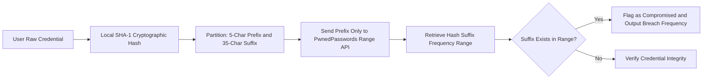

# Breach Checker App

<div align="center">

[](https://python.org)
[](https://haveibeenpwned.com)
[](LICENSE)

</div>

A privacy-first security CLI validation engine that queries global vulnerability databases to determine whether credentials have been exposed in documented corporate security breaches.

---

## Verification Pipeline



---

## Features

- **K-Anonymity Model**: Raw passwords never leave the local environment; only the first 5 hexadecimal characters of the SHA-1 hash are transmitted.
- **Instant Global Verification**: Queries hundreds of millions of exposed credentials cataloged in international data dumps.
- **Zero Third-Party Tracking**: Completely stateless, local, and telemetry-free execution.

---

## Getting Started

1. Clone the repository:
   ```bash
   git clone https://github.com/Midhun-M-git/breach-checker-app.git
   cd breach-checker-app
   ```

2. Install dependencies:
   ```bash
   pip install -r requirements.txt
   ```

3. Run the verification CLI:
   ```bash
   python main.py
   ```

---

## License

This project is licensed under the MIT License. See the [LICENSE](LICENSE) file for details.
